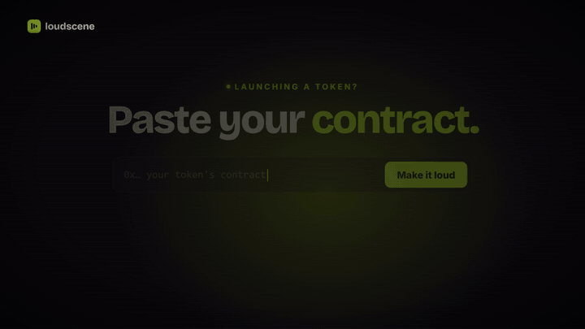

<p align="center">
  <a href="https://www.loudscene.com"></a>
</p>

<h1 align="center">loudscene</h1>

<p align="center"><strong>Paste your token's contract. We make it loud.</strong><br>
Launch films for any token from your terminal, your scripts and your AI agents.</p>

<p align="center">
  <a href="https://www.npmjs.com/package/loudscene"></a>
  <a href="LICENSE"></a>
  = 20" src="https://img.shields.io/badge/node-%3E%3D20-ccff00?labelColor=0d0c10">
  <a href="https://www.loudscene.com/docs/mcp"></a>
  <a href="https://robinhoodchain.blockscout.com/token/0xCD291FA4d3e2Eb43e4639625092D31ae10E61111"></a>
</p>

<p align="center">
  <a href="https://www.loudscene.com"></a>
</p>

loudscene is the marketing layer for crypto projects: a **launch film**, **memes** for the community and a **community manager** for the Telegram group, all from one contract address. This repository is the open-source **`loudscene` command line** and its **stdio bridge to the loudscene MCP server**, so you can make films from a terminal, a CI job or any AI agent.

- **Films from a contract.** `--token 0x…` and the film carries the token's live figures and its own image.
- **Films from a website.** `--url yourbrand.com` reads the brand (colours, fonts, logo, tone) first.
- **Agents.** A remote MCP server for Claude, ChatGPT, Cursor and Windsurf, and `loudscene mcp` for clients that only speak stdio.
- **Every format.** 16:9, 9:16, 1:1 and 4:5 MP4s, up to 4K.

## Quick start

> The package is on its way to npm. Until `npx loudscene` resolves, install it from source:
> `git clone https://github.com/budeanulucian07-max/loudscene && cd loudscene && pnpm install && pnpm build && npm link`

You need Node 20+ and an API key: loudscene → **Settings → API keys** (Pro plan and up).

```sh
npx loudscene login                      # paste your ls_live_… key (kept in ~/.config/loudscene, 0600)

# A launch film for a token, straight from its contract
npx loudscene create --token 0xCD291FA4d3e2Eb43e4639625092D31ae10E61111 --formats 16:9 --render --wait

# A film on a website's brand
npx loudscene create --url yourbrand.com --brief "We just launched v2: twice as fast." --formats 9:16,1:1 --wait
npx loudscene render <video id> --formats 9:16,1:1 --wait
npx loudscene download <render id> -o ./videos
```

Prefer no install at all? Paste a contract on [loudscene.com](https://www.loudscene.com): the film plays right there, free, no account, no wallet.

## Commands

| Command | Options | What it does |
|---|---|---|
| `login` | `[--key ls_live_…]` | Saves an API key to `~/.config/loudscene/config.json` |
| `logout` | | Forgets the saved key |
| `whoami` | | Shows which key and server are in use and checks the key |
| `brand <url>` | `[--wait]` | Extracts a brand kit from a website |
| `brands` | | Lists brand kits |
| `stories` | | Lists story templates and their fields |
| `create` | `--token <contract or link>` · `--url <site>` · `--brand <kit id>` · `--brief "<text>"` · `--story <id>` · `--formats 16:9,9:16,1:1,4:5` · `--duration <s>` · `--locale <code>` · `--title <text>` · `--wait` · `--render` | Creates a video. With `--token` the brief is optional. `--wait` waits for the AI; `--render` then renders every format |
| `status <id>` | | Status and progress of a job, a video or a render |
| `render <video id>` | `[--formats …] [--resolution 720\|1080\|2160] [--wait]` | Renders MP4s (default: the video's main format) |
| `download <render id>` | `[-o <dir>] [--wait]` | Saves a finished render as an MP4 |
| `open <video id>` | | Opens the video in the loudscene editor |
| `mcp` | | Runs a stdio MCP server that forwards to `/api/mcp` |

Global options: `--json` (machine-readable output), `--api-url <url>`, `--timeout <s>`, `-h`, `-v`.
Environment: `LOUDSCENE_API_KEY` overrides the saved key, `LOUDSCENE_API_URL` the server.

## Use it from AI agents (MCP)

loudscene runs a remote MCP server at **`https://www.loudscene.com/api/mcp`** (Streamable HTTP). Claude and ChatGPT connect to it as a connector with sign-in (no key); coding agents use a key as a Bearer header. Ready-made configs are in [`examples/mcp`](examples/mcp).

<details open>
<summary><strong>Claude Code</strong></summary>

```sh
claude mcp add --transport http loudscene https://www.loudscene.com/api/mcp \
  --header "Authorization: Bearer ls_live_…"
```
</details>

<details>
<summary><strong>Cursor</strong> · <code>~/.cursor/mcp.json</code></summary>

```json
{
  "mcpServers": {
    "loudscene": {
      "url": "https://www.loudscene.com/api/mcp",
      "headers": { "Authorization": "Bearer ls_live_…" }
    }
  }
}
```
</details>

<details>
<summary><strong>Claude Desktop</strong> · stdio bridge</summary>

```json
{
  "mcpServers": {
    "loudscene": {
      "command": "npx",
      "args": ["-y", "loudscene", "mcp"],
      "env": { "LOUDSCENE_API_KEY": "ls_live_…" }
    }
  }
}
```
`loudscene mcp` reads one JSON-RPC message per line on stdin, forwards it to `/api/mcp` with your key and writes each answer as one line on stdout (logs go to stderr).
</details>

<details>
<summary><strong>Windsurf</strong> · <code>~/.codeium/windsurf/mcp_config.json</code></summary>

```json
{
  "mcpServers": {
    "loudscene": {
      "serverUrl": "https://www.loudscene.com/api/mcp",
      "headers": { "Authorization": "Bearer ls_live_…" }
    }
  }
}
```
</details>

Then just ask: *"make a launch film for my token 0x…"*.

### Tools

| Tool | What it does | Parameters (`*` required) |
|---|---|---|
| `extract_brand` | Reads a public website and saves its brand (colours, fonts, logo, tone) as a brand kit | `url`*, `idempotency_key` |
| `list_brand_kits` | Lists the workspace's brand kits with their colours and fonts | |
| `list_stories` | Lists the built-in stories (templates) with their editable fields | |
| `create_video` | Creates a film on a brand, or on a token's brand when you pass `token` (a contract address or token link) | `token`, `url`, `brand_kit_id`, `brief`, `story_id`, `fields`, `format`, `duration_sec`, `locale`, `title`, `idempotency_key` |
| `get_job` | Status, stage, progress and result of a job | `job_id`* |
| `wait_for_job` | Waits server-side (up to 25 s) until a job finishes | `job_id`*, `timeout_sec` |
| `get_video` | A video's status, scenes, field values and editor link | `video_id`*, `include_doc` |
| `update_video` | Changes field values and/or the title, without AI and at no cost | `video_id`*, `fields`, `title`, `note` |
| `create_stills` | PNG stills of the current version, to check the look before rendering | `video_id`*, `times`*, `format` |
| `render_video` | Renders MP4s in one or more formats | `video_id`*, `formats`*, `resolution`, `idempotency_key` |
| `get_render` | A render's status; once done, a signed MP4 URL and a poster | `render_id`* |
| `wait_for_render` | Waits server-side (up to 25 s) until a render finishes | `render_id`*, `timeout_sec` |

Full reference: [loudscene.com/docs/mcp](https://www.loudscene.com/docs/mcp).

## Examples

- [`examples/token-film.mjs`](examples/token-film.mjs): contract in, MP4 out, with the REST API and nothing but Node 20.
- [`examples/token-film.sh`](examples/token-film.sh): the same first call with curl.
- [`examples/mcp`](examples/mcp): MCP configs for Claude Code, Cursor, Claude Desktop and Windsurf.

The REST API is documented at [loudscene.com/docs/api](https://www.loudscene.com/docs/api) (OpenAPI: `/api/v1/openapi.json`).

## Receipts by HEY

**Coming next: launch films with receipts.** The films we make from a contract will show what the team behind the token has actually shipped, with sources, from [HEY Research Lab](https://heyresearch.xyz). Hype is easy to fake; a timeline of shipped work isn't.

## Credits and pricing

Making a film is free to try on [loudscene.com](https://www.loudscene.com) (no account, no wallet). Through the API, AI generations count against your plan's monthly generations, and the first render of a video version costs 1 credit per started minute and covers every format of that version. Plans: [loudscene.com/pricing](https://www.loudscene.com/pricing).

## Official links

| | |
|---|---|
| Website | [loudscene.com](https://www.loudscene.com) |
| Docs | [loudscene.com/docs](https://www.loudscene.com/docs) |
| X | [@loudscene](https://x.com/loudscene) |
| Telegram | [t.me/loudscene](https://t.me/loudscene) (the only official group) |

### $LOUD (official)

The only official contract, on Robinhood Chain:

```
0xCD291FA4d3e2Eb43e4639625092D31ae10E61111
```

Anything else using the name is not us. 30% of every payment on loudscene buys back and burns $LOUD, each burn on chain: [loudscene.com/transparency](https://www.loudscene.com/transparency).

## Development

```sh
pnpm install
pnpm typecheck
pnpm test
pnpm build        # dist/cli.js
node dist/cli.js --help
```

See [CONTRIBUTING.md](CONTRIBUTING.md). Security reports: [SECURITY.md](SECURITY.md).

<details>
<summary>Suggested repository description and topics</summary>

- **Description:** Paste your token's contract. We make it loud. The loudscene CLI and MCP bridge: launch films from your terminal and your AI agents.
- **Topics:** `loudscene` `mcp` `mcp-server` `cli` `ai-video` `robinhood-chain` `crypto-marketing` `launch-film`
- **Website:** https://www.loudscene.com
</details>

## Built by Nextry

loudscene is built by [Nextry](https://nextry.ro/en), a digital marketing agency from Romania with a real, doxxed team. MIT licensed: see [LICENSE](LICENSE).
